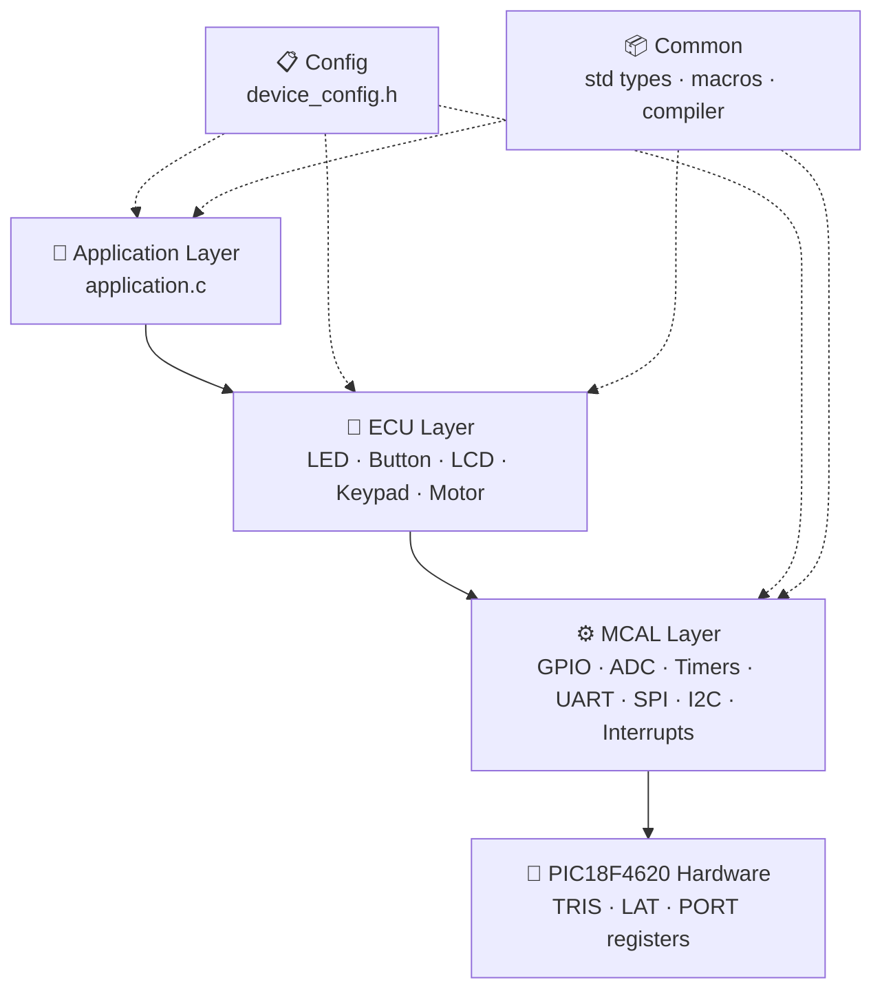

<div align="center">

# ⚡ PIC18 Embedded Drivers

**A clean, layered, AUTOSAR-inspired driver library for the Microchip PIC18F4620**

[](https://www.microchip.com/en-us/product/PIC18F4620)
[](https://www.microchip.com/en-us/tools-resources/develop/mplab-xc-compilers)
[](https://www.microchip.com/en-us/tools-resources/develop/mplab-x-ide)
[](#)
[](LICENSE)

[English](#-overview) · [العربية](#-نظرة-عامة)

</div>

---

## 📖 Overview

**PIC18 Embedded Drivers** is a growing collection of reusable, well-documented peripheral and device drivers for the **PIC18F4620** microcontroller, written in C for the **MPLAB XC8** compiler.

The codebase follows a strict **layered architecture** (Config → Common → MCAL → ECU → Application), so every new driver (ADC, Timers, UART, LCD, …) slots in beside the existing ones without touching unrelated code. Every feature can be switched on or off from a **single configuration file**.

## 🏗️ Architecture



| Layer | Responsibility |
|---|---|
| **Application** | Business logic only, talks to ECU drivers. |
| **ECU** | External components (LEDs, buttons, displays) built on MCAL. |
| **MCAL** | Microcontroller peripherals, the only layer touching registers. |
| **Common** | Standard types (`uint8`, `Std_ReturnType`), bit macros, compiler abstraction. |
| **Config** | Single point of configuration: clock, feature toggles, dependency checks. |

## 📂 Project Structure

```text
pic18-embedded-drivers/
├── application.c              # Demo application + configuration bits
├── Config/
│   └── device_config.h        # ⭐ Single point of configuration
├── Common/
│   ├── mcal_std_types.h       # Fixed-width types, Std_ReturnType, E_OK/E_NOT_OK
│   ├── std_macros.h           # Bit manipulation & register-access macros
│   ├── compiler.h             # Compiler abstraction (XC8 / GCC)
│   └── std_libraries.h        # Standard C library includes
├── MCAL_Layer/
│   └── GPIO/
│       ├── hal_gpio.h         # GPIO interface (Struct + Direct APIs)
│       └── hal_gpio.c         # GPIO implementation
├── ECU_Layer/
│   └── LED/
│       ├── ecu_led.h          # LED interface
│       └── ecu_led.c          # LED implementation
├── LICENSE
└── README.md
```

> New drivers follow the same pattern: `MCAL_Layer/<PERIPHERAL>/hal_<peripheral>.{h,c}` or `ECU_Layer/<DEVICE>/ecu_<device>.{h,c}`, plus a toggle in `device_config.h`.

## 🗺️ Drivers Roadmap

| # | Driver | Layer | Status | Notes |
|:-:|---|:-:|:-:|---|
| 1 | **GPIO** | MCAL | ✅ Done | Pin & port APIs, Struct + Direct styles, range checks |
| 2 | **LED** | ECU | ✅ Done | Active-high / active-low, on / off / toggle |
| 3 | Push Button | ECU | 🗓️ Planned | Debouncing, active-high / low |
| 4 | Interrupts (INTx, RBx) | MCAL | 🗓️ Planned | External & on-change interrupts, priority |
| 5 | ADC | MCAL | 🗓️ Planned | 10-bit, polling & interrupt modes |
| 6 | Timers (0/1/2/3) | MCAL | 🗓️ Planned | Timer/counter modes, prescalers |
| 7 | CCP / PWM | MCAL | 🗓️ Planned | Capture, compare, PWM |
| 8 | UART (EUSART) | MCAL | 🗓️ Planned | Async TX/RX, baud-rate calculation |
| 9 | SPI (MSSP) | MCAL | 🗓️ Planned | Master / slave |
| 10 | I2C (MSSP) | MCAL | 🗓️ Planned | Master / slave |
| 11 | Character LCD | ECU | 🗓️ Planned | 4-bit / 8-bit modes |
| 12 | Keypad | ECU | 🗓️ Planned | 4×4 matrix scanning |
| 13 | 7-Segment | ECU | 🗓️ Planned | Multiplexed display |
| 14 | DC Motor / Relay | ECU | 🗓️ Planned | Direction & on/off control |

<sub>Legend: ✅ Done · 🚧 In progress · 🗓️ Planned</sub>

## ✨ Features

- 🧱 **Layered architecture**: Config, Common, MCAL, ECU, Application.
- 🎛️ **Configuration pattern**: enable/disable any module from `device_config.h`.
- 🔁 **Dual GPIO APIs**: struct-based (`pin_config_t`) and direct (`port, pin`) calls.
- 🛡️ **Defensive programming**: NULL-pointer protection and range checking on every parameter.
- ⚡ **Fast register access**: TRIS/LAT/PORT register arrays.
- ✍️ **LAT for writes, PORT for reads**: avoids read-modify-write issues.
- ✅ **AUTOSAR-style returns**: every API returns `Std_ReturnType` (`E_OK` / `E_NOT_OK`).
- 🔍 **Compile-time dependency checks**: e.g. LED requires GPIO.
- 📝 **Fully Doxygen-documented** functions and types.

## 🚀 Quick Start

### Requirements
- [MPLAB X IDE](https://www.microchip.com/en-us/tools-resources/develop/mplab-x-ide)
- [MPLAB XC8 Compiler](https://www.microchip.com/en-us/tools-resources/develop/mplab-xc-compilers)
- PIC18F4620 board, or [Proteus](https://www.labcenter.com/) for simulation

### Build
1. Clone the repository:
   ```bash
   git clone https://github.com/Mkko000/pic18-embedded-drivers.git
   ```
2. In MPLAB X create a new **Standalone Project**, device **PIC18F4620**, compiler **XC8**.
3. Add the source files (`application.c`, `hal_gpio.c`, `ecu_led.c`) and headers, keeping the folder structure.
4. Build (🔨) and flash the generated `.hex`, or load it into Proteus.

### Usage Example

```c
#include <xc.h>
#include "Config/device_config.h"
#include "ECU_Layer/LED/ecu_led.h"

led_config_t led_red = {
    .port   = PORTC_INDEX,
    .pin    = GPIO_PIN0,
    .active = LED_ACTIVE_HIGH_MODE
};

void main(void) {
    led_initialize(&led_red);
    while (1) {
        led_toggle(&led_red);
        __delay_ms(500);
    }
}
```

GPIO can also be used directly:

```c
pin_config_t button = { .port = PORTB_INDEX, .pin = GPIO_PIN0,
                        .direction = GPIO_DIRECTION_INPUT };
logic_t state;

gpio_pin_direction_initialize(&button);
gpio_pin_read_logic(&button, &state);
```

## ⚙️ Configuration

All features are controlled from **`Config/device_config.h`**:

```c
#define _XTAL_FREQ                 4000000UL       /* Oscillator frequency */

#define GPIO_MODULE_ENABLE         CONFIG_ENABLE
#define GPIO_STRUCT_API_ENABLE     CONFIG_ENABLE
#define GPIO_DIRECT_API_ENABLE     CONFIG_ENABLE

#define LED_MODULE_ENABLE          CONFIG_ENABLE
#define BUTTON_MODULE_ENABLE       CONFIG_DISABLE
#define ADC_MODULE_ENABLE          CONFIG_DISABLE
```

Invalid combinations fail at compile time:

```c
#if (LED_MODULE_ENABLE == CONFIG_ENABLE) && (GPIO_MODULE_ENABLE != CONFIG_ENABLE)
    #error "LED_MODULE requires GPIO_MODULE to be enabled!"
#endif
```

## 🔌 Hardware Setup (Demo)

| Component | Connection |
|---|---|
| Crystal | 4 MHz on OSC1/OSC2 with 2 × 22 pF capacitors |
| MCLR | 10 kΩ pull-up to VDD |
| Red LED | RC0 → 330 Ω → GND |
| Green LED | RC1 → 330 Ω → GND |
| Blue LED | RC2 → 330 Ω → GND |
| Power | VDD = +5 V, VSS = GND |

The demo cycles Red → Green → Blue every 500 ms.

## 📐 Coding Standards

- **AUTOSAR-style types**: `uint8`, `sint16`, `Std_ReturnType`, `E_OK` / `E_NOT_OK`.
- **One definition per macro**, in its logical home (`Common/` for shared macros, module headers for module-specific ones).
- **Include guards** on every header; relative include paths that mirror the folder layout.
- **Doxygen** comments (`@brief`, `@param`, `@return`) on every public API.
- **Naming**: `hal_<peripheral>` for MCAL, `ecu_<device>` for ECU, `snake_case` functions, `UPPER_CASE` macros, `_t` suffix for types.
- Only the MCAL layer accesses hardware registers.

---

## 🇪🇬 نظرة عامة

<div dir="rtl">

**PIC18 Embedded Drivers** مكتبة درايفرز للميكروكنترولر **PIC18F4620** مكتوبة بلغة C للكومبايلر **XC8**، والمكتبة بتكبر مع كل درايفر جديد.

- **معمارية طبقية:** Config ← Common ← MCAL ← ECU ← Application. وأي درايفر جديد (ADC أو Timer أو UART أو LCD…) بيتحط جنب اللي موجود من غير ما نلمس باقي الكود.
- **نقطة تحكم واحدة:** كل الموديولات بتتفعّل أو تتقفل من `Config/device_config.h`.
- **أسلوب AUTOSAR:** كل دالة بترجع `Std_ReturnType`، وفيه حماية من الـ NULL Pointers وفحص لكل البارامترات.
- **توثيق كامل بـ Doxygen** لكل دالة وكل نوع.

### حالة الدرايفرز
- ✅ **GPIO** و **LED** خلصوا.
- 🗓️ الجاي: Button، Interrupts، ADC، Timers، CCP/PWM، UART، SPI، I2C، LCD، Keypad، 7-Segment.

### التشغيل
اعمل Clone للريبو، وافتح مشروع جديد في MPLAB X على PIC18F4620 بالكومبايلر XC8، وضيف الملفات بنفس ترتيب الفولدرات، واعمل Build. بعدها تقدر تحمّل ملف الـ `.hex` على البوردة أو تجربه على بروتس.

</div>

---

## 👤 Author

<div align="center">

**Mohammed El Sisi**

Embedded Systems Engineer

[](https://github.com/Mkko000)

⭐ If you find this project useful, consider giving it a star!

</div>

## 📄 License

This project is licensed under the **MIT License**. See [LICENSE](LICENSE) for details.
