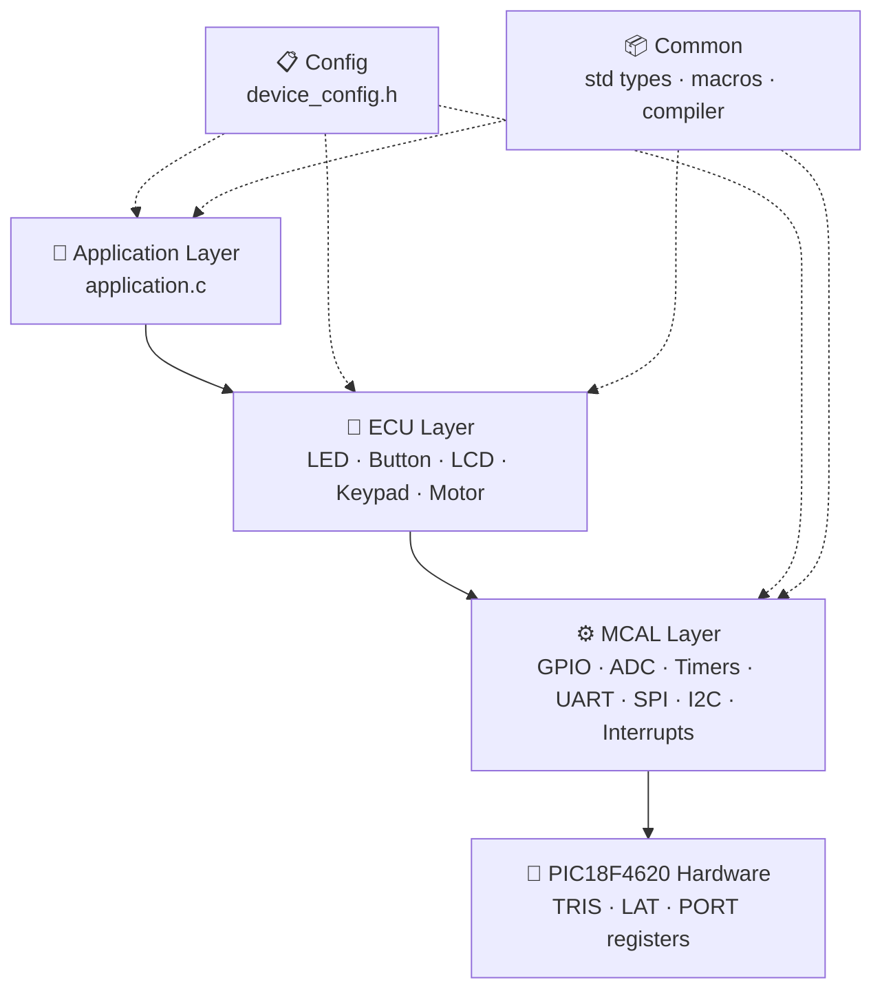

<div align="center">

# ⚡ PIC18 Embedded Drivers

**A clean, layered, AUTOSAR-inspired driver library for the Microchip PIC18F4620**

[](https://www.microchip.com/en-us/product/PIC18F4620)
[](https://www.microchip.com/en-us/tools-resources/develop/mplab-xc-compilers)
[](https://www.microchip.com/en-us/tools-resources/develop/mplab-x-ide)
[](#)
[](LICENSE)

[English](#-overview) · [العربية](#-نظرة-عامة)

</div>

---

## 📖 Overview

**PIC18 Embedded Drivers** is a growing collection of reusable, well-documented peripheral and device drivers for the **PIC18F4620** microcontroller, written in C for the **MPLAB XC8** compiler.

The codebase follows a strict **layered architecture** (Config → Common → MCAL → ECU → Application), so every new driver (ADC, Timers, UART, LCD, …) slots in beside the existing ones without touching unrelated code. Every feature can be switched on or off from a **single configuration file**.

## 🏗️ Architecture



| Layer | Responsibility |
|---|---|
| **Application** | Business logic only, talks to ECU drivers. |
| **ECU** | External components (LEDs, buttons, displays) built on MCAL. |
| **MCAL** | Microcontroller peripherals, the only layer touching registers. |
| **Common** | Standard types (`uint8`, `Std_ReturnType`), bit macros, compiler abstraction. |
| **Config** | Single point of configuration: clock, feature toggles, dependency checks. |

## 📂 Project Structure

```text
pic18-embedded-drivers/
├── application.c              # Demo application (LED blink)
├── Config/
│   ├── device_config.h        # ⭐ Single point of configuration
│   └── config_bits.c          # ⭐ Configuration bits (fuses) + oscillator selection
├── Common/
│   ├── mcal_std_types.h       # Fixed-width types, Std_ReturnType, E_OK/E_NOT_OK
│   ├── std_macros.h           # Bit manipulation & register-access macros
│   ├── compiler.h             # Compiler abstraction (XC8 / GCC)
│   └── std_libraries.h        # Standard C library includes
├── MCAL_Layer/
│   └── GPIO/
│       ├── hal_gpio.h         # GPIO interface (Struct + Direct APIs)
│       └── hal_gpio.c         # GPIO implementation
├── ECU_Layer/
│   └── LED/
│       ├── ecu_led.h          # LED interface
│       └── ecu_led.c          # LED implementation
├── Projects/
│   ├── 01_LED_Chaser/         # main.c + README.md
│   ├── 02_Traffic_Light/
│   ├── 03_Binary_Counter/
│   └── 04_Morse_Code/
├── examples/
│   ├── gpio_struct_api_example.c   # Minimal Struct API blink
│   └── gpio_direct_api_example.c   # Minimal Direct API blink
├── CHANGELOG.md
├── LICENSE
└── README.md
```

> New drivers follow the same pattern: `MCAL_Layer/<PERIPHERAL>/hal_<peripheral>.{h,c}` or `ECU_Layer/<DEVICE>/ecu_<device>.{h,c}`, plus a toggle in `device_config.h`.

## 🧪 Projects

GPIO-only projects you can build on top of the drivers. Each one is self-contained: its `main.c` plus the driver sources. **Build one project per MPLAB X build**, and don't add the root `application.c` alongside it, since every project defines its own `main()`.

| # | Project | Drivers | Highlights |
|:-:|---|---|---|
| 01 | [LED Chaser](Projects/01_LED_Chaser) | GPIO | Knight Rider + pattern-table effects (bounce, fill, center-out, alternate) |
| 02 | [4-Way Traffic Light](Projects/02_Traffic_Light) | GPIO | 6-state table-driven FSM, 12 LEDs, emergency button with internal pull-up |
| 03 | [Binary Counter](Projects/03_Binary_Counter) | GPIO | 0–255, Up/Down/Reset, debounce + edge detection |
| 04 | [Morse Code](Projects/04_Morse_Code) | GPIO + LED | A–Z / 0–9 lookup table, unit-based timing, any string |

## 🗺️ Drivers Roadmap

| # | Driver | Layer | Status | Notes |
|:-:|---|:-:|:-:|---|
| 1 | **GPIO** | MCAL | ✅ Done | Pin & port APIs, Struct + Direct styles, range checks |
| 2 | **LED** | ECU | ✅ Done | Active-high / active-low, on / off / toggle / get state |
| 3 | **Analog / Digital pin config** | MCAL | ✅ Done | ANx lookup table, minimal ADCON1 PCFG threshold |
| 4 | **PORTB internal pull-ups** | MCAL | ✅ Done | `INTCON2.RBPU` enable / disable |
| 5 | Push Button | ECU | 🗓️ Planned | Debouncing, active-high / low |
| 6 | Interrupts (INTx, RBx) | MCAL | 🗓️ Planned | External & on-change interrupts, priority |
| 7 | ADC | MCAL | 🗓️ Planned | 10-bit, polling & interrupt modes |
| 8 | Timers (0/1/2/3) | MCAL | 🗓️ Planned | Timer/counter modes, prescalers |
| 9 | CCP / PWM | MCAL | 🗓️ Planned | Capture, compare, PWM |
| 10 | UART (EUSART) | MCAL | 🗓️ Planned | Async TX/RX, baud-rate calculation |
| 11 | SPI (MSSP) | MCAL | 🗓️ Planned | Master / slave |
| 12 | I2C (MSSP) | MCAL | 🗓️ Planned | Master / slave |
| 13 | Character LCD | ECU | 🗓️ Planned | 4-bit / 8-bit modes |
| 14 | Keypad | ECU | 🗓️ Planned | 4×4 matrix scanning |
| 15 | 7-Segment | ECU | 🗓️ Planned | Multiplexed display |
| 16 | DC Motor / Relay | ECU | 🗓️ Planned | Direction & on/off control |

<sub>Legend: ✅ Done · 🚧 In progress · 🗓️ Planned</sub>

## ✨ Features

- 🧱 **Layered architecture**: Config, Common, MCAL, ECU, Application.
- 🎛️ **Configuration pattern**: enable/disable any module from `device_config.h`.
- 🔁 **Dual GPIO APIs**: struct-based (`pin_config_t`) and direct (`port, pin`) calls. The two APIs are **fully independent**: each has its own validation and register access, and either one can be enabled alone.
- 🎚️ **Smart analog/digital selection**: pin → ANx lookup table; the driver computes the minimal `ADCON1.PCFG` threshold for the pins you request, and `gpio_pin_setup()` makes pins digital automatically.
- 🔼 **PORTB weak pull-ups**: one call, no external resistors for buttons.
- 🎯 **Pin-aware port operations**: port writes never touch non-existent pins (RE3–RE7), and port toggle flips every existing pin's LAT bit (inputs take the new value when they become outputs).
- 🔒 **Encapsulated registers**: file-local `static volatile uint8 * const` register tables.
- 🛡️ **Defensive programming**: NULL-pointer protection and range checking on every parameter.
- ⚡ **Fast register access**: TRIS/LAT/PORT register arrays.
- ✍️ **LAT for writes, PORT for reads**: avoids read-modify-write issues.
- ✅ **AUTOSAR-style returns**: every API returns `Std_ReturnType` (`E_OK` / `E_NOT_OK`).
- 🔍 **Compile-time dependency checks**: e.g. LED requires GPIO.
- 📝 **Fully Doxygen-documented** functions and types.

## 📚 API Reference

### GPIO (MCAL)

| Group | Functions |
|---|---|
| Init | `gpio_init()` |
| Pin (Direct) | `gpio_pin_setup`, `gpio_pin_set_direction`, `gpio_pin_get_direction`, `gpio_pin_write`, `gpio_pin_read`, `gpio_pin_read_latch`, `gpio_pin_toggle`, `gpio_pin_deinit` |
| Port (Direct) | `gpio_port_setup`, `gpio_port_set_direction`, `gpio_port_get_direction`, `gpio_port_write`, `gpio_port_read`, `gpio_port_toggle` |
| Pin (Struct) | `gpio_pin_initialize`, `gpio_pin_direction_initialize`, `gpio_pin_get_direction_status`, `gpio_pin_write_logic`, `gpio_pin_read_logic`, `gpio_pin_read_latch_logic`, `gpio_pin_toggle_logic`, `gpio_pin_deinitialize` |
| Port (Struct) | `gpio_port_initialize`, `gpio_port_direction_initialize`, `gpio_port_get_direction_status`, `gpio_port_write_logic`, `gpio_port_read_logic`, `gpio_port_toggle_logic` |
| Analog / Digital | `gpio_pin_set_analog`, `gpio_pin_set_digital`, `gpio_pin_is_analog` |
| Pull-ups | `gpio_portb_pullup_enable`, `gpio_portb_pullup_disable` |
| Mask constants | `GPIO_PORT_ALL_OUTPUT`, `GPIO_PORT_ALL_INPUT`, `GPIO_PORT_ALL_LOW`, `GPIO_PORT_ALL_HIGH`, `GPIO_PIN0_MASK` … `GPIO_PIN7_MASK` |

### LED (ECU)

`led_initialize`, `led_on`, `led_off`, `led_toggle`, `led_get_state`

All functions return `Std_ReturnType` (`E_OK` / `E_NOT_OK`).

### ⚠️ Analog pins: hardware note

PIC18F4620 selects analog pins with `ADCON1<PCFG3:0>`, a **threshold** scheme (`AN0…ANn` analog), not per-pin. Requesting a high channel (e.g. `AN4` = RA5) makes every lower channel (`AN0–AN3`) analog too. The driver tracks every requested channel and always programs the **minimal** threshold. `gpio_pin_set_digital()` returns `E_NOT_OK` if a pin must stay analog because a higher channel is still in use.

| ANx | Pin | ANx | Pin | ANx | Pin |
|:-:|:-:|:-:|:-:|:-:|:-:|
| AN0 | RA0 | AN5 | RE0 | AN10 | RB1 |
| AN1 | RA1 | AN6 | RE1 | AN11 | RB4 |
| AN2 | RA2 | AN7 | RE2 | AN12 | RB0 |
| AN3 | RA3 | AN8 | RB2 | | |
| AN4 | RA5 | AN9 | RB3 | | |

## 🚀 Quick Start

### Requirements
- [MPLAB X IDE](https://www.microchip.com/en-us/tools-resources/develop/mplab-x-ide)
- [MPLAB XC8 Compiler](https://www.microchip.com/en-us/tools-resources/develop/mplab-xc-compilers)
- PIC18F4620 board, or [Proteus](https://www.labcenter.com/) for simulation

### Build
1. Clone the repository:
   ```bash
   git clone https://github.com/Mkko000/pic18-embedded-drivers.git
   ```
2. In MPLAB X create a new **Standalone Project**, device **PIC18F4620**, compiler **XC8**.
3. Add the source files (`application.c`, `Config/config_bits.c`, `hal_gpio.c`, `ecu_led.c`) and headers, keeping the folder structure. Add `config_bits.c` **exactly once**: it holds every `#pragma config`.
4. Build (🔨) and flash the generated `.hex`, or load it into Proteus.

### Usage Example

```c
#include <xc.h>
#include "Config/device_config.h"
#include "ECU_Layer/LED/ecu_led.h"

led_config_t led_red = {
    .port   = PORTC_INDEX,
    .pin    = GPIO_PIN0,
    .active = LED_ACTIVE_HIGH_MODE
};

void main(void) {
    gpio_init();                 /* all pins digital */
    led_initialize(&led_red);
    while (1) {
        led_toggle(&led_red);
        __delay_ms(500);
    }
}
```

Minimal stand-alone examples for each API live in [`examples/`](examples): [Struct API](examples/gpio_struct_api_example.c) · [Direct API](examples/gpio_direct_api_example.c).

GPIO can also be used directly:

```c
/* Button on RB0 using the internal pull-up (pressed = LOW) */
logic_t state;
gpio_portb_pullup_enable();
gpio_pin_setup(PORTB_INDEX, GPIO_PIN0, GPIO_DIRECTION_INPUT, GPIO_LOW);
gpio_pin_read(PORTB_INDEX, GPIO_PIN0, &state);

/* PORTD: RD0-RD3 outputs, RD4-RD7 inputs, all outputs start LOW */
gpio_port_setup(PORTD_INDEX,
                GPIO_PIN4_MASK | GPIO_PIN5_MASK | GPIO_PIN6_MASK | GPIO_PIN7_MASK,
                GPIO_PORT_ALL_LOW);

/* Potentiometer on RA0 (AN0) */
gpio_pin_set_analog(PORTA_INDEX, GPIO_PIN0);
```

## ⚙️ Configuration

All features are controlled from **`Config/device_config.h`**:

```c
#define _XTAL_FREQ                 4000000UL       /* Oscillator frequency */

#define GPIO_MODULE_ENABLE         CONFIG_ENABLE
#define GPIO_STRUCT_API_ENABLE     CONFIG_ENABLE
#define GPIO_DIRECT_API_ENABLE     CONFIG_ENABLE   /* independent of STRUCT API */
#define GPIO_ANALOG_CONFIG_ENABLE  CONFIG_ENABLE
#define GPIO_INIT_ALL_DIGITAL      CONFIG_ENABLE
#define GPIO_PORTB_PULLUP_ENABLE   CONFIG_ENABLE

#define LED_MODULE_ENABLE          CONFIG_ENABLE
#define BUTTON_MODULE_ENABLE       CONFIG_DISABLE
#define ADC_MODULE_ENABLE          CONFIG_DISABLE
```

**Oscillator & configuration bits:** every `#pragma config` lives in `Config/config_bits.c`. Pick the clock in `device_config.h`:

```c
#define _XTAL_FREQ   4000000UL      /* resulting CPU clock */
#define OSC_MODE     OSC_MODE_HS    /* OSC_MODE_XT / HS / HSPLL / INTIO67 */
```

A compile-time check stops the build if `_XTAL_FREQ` doesn't fit the mode: HS needs 4–25 MHz, XT ≤ 4 MHz, HSPLL 16–40 MHz (4× the crystal), and INTIO67 must be one of the internal frequencies.

**Independent APIs:** `GPIO_STRUCT_API_ENABLE` and `GPIO_DIRECT_API_ENABLE` can be enabled together or alone. Each has its own validation and register access. Shared low-level parts (register tables, valid-pin masks, analog/digital and pull-up support) are compiled whenever `GPIO_MODULE_ENABLE` is on. The LED driver automatically uses the Direct API if it is enabled, otherwise the Struct API.

Invalid combinations fail at compile time:

```c
#if (LED_MODULE_ENABLE == CONFIG_ENABLE) && (GPIO_MODULE_ENABLE != CONFIG_ENABLE)
    #error "LED_MODULE requires GPIO_MODULE to be enabled!"
#endif
```

## 🔌 Hardware Setup (Demo)

| Component | Connection |
|---|---|
| Crystal | 4 MHz on OSC1/OSC2 with 2 × 22 pF capacitors |
| MCLR | 10 kΩ pull-up to VDD |
| Red LED | RC0 → 330 Ω → GND |
| Green LED | RC1 → 330 Ω → GND |
| Blue LED | RC2 → 330 Ω → GND |
| Power | VDD = +5 V, VSS = GND |

The demo cycles Red → Green → Blue every 500 ms.

## 📐 Coding Standards

- **AUTOSAR-style types**: `uint8`, `sint16`, `Std_ReturnType`, `E_OK` / `E_NOT_OK`.
- **One definition per macro**, in its logical home (`Common/` for shared macros, module headers for module-specific ones).
- **Include guards** on every header; relative include paths that mirror the folder layout.
- **Doxygen** comments (`@brief`, `@param`, `@return`) on every public API.
- **Naming**: `hal_<peripheral>` for MCAL, `ecu_<device>` for ECU, `snake_case` functions, `UPPER_CASE` macros, `_t` suffix for types.
- Only the MCAL layer accesses hardware registers.

---

## 🇪🇬 نظرة عامة

<div dir="rtl">

**PIC18 Embedded Drivers** مكتبة درايفرز للميكروكنترولر **PIC18F4620** مكتوبة بلغة C للكومبايلر **XC8**، والمكتبة بتكبر مع كل درايفر جديد.

- **معمارية طبقية:** Config ← Common ← MCAL ← ECU ← Application. وأي درايفر جديد (ADC أو Timer أو UART أو LCD…) بيتحط جنب اللي موجود من غير ما نلمس باقي الكود.
- **نقطة تحكم واحدة:** كل الموديولات بتتفعّل أو تتقفل من `Config/device_config.h`.
- **أسلوب AUTOSAR:** كل دالة بترجع `Std_ReturnType`، وفيه حماية من الـ NULL Pointers وفحص لكل البارامترات.
- **توثيق كامل بـ Doxygen** لكل دالة وكل نوع.
- **APIين مستقلين تماماً:** الـ Struct API والـ Direct API كل واحد منهم ليه التحقق بتاعه وبيتعامل مع الريجسترات بنفسه، وتقدر تفعّل أي واحد فيهم لوحده. أما الأجزاء المشتركة زي جداول الريجسترات وماسك البنات الموجودة ودوال الـ Analog والـ Pull-up، فبتشتغل طول ما الـ GPIO متفعّل.
- **عمليات البورت ذكية:** مش بتلمس البنات اللي مش موجودة زي RE3–RE7، والـ toggle بيقلب الـ LAT لكل البنات الموجودة. البن الـ Input مش بيتأثر غير لما يتحول Output.

### حالة الدرايفرز
- ✅ **GPIO** و **LED** خلصوا.
- ✅ **إعداد Analog/Digital:** فيه جدول بيربط كل بن بقناة ANx، والدرايفر بيحسب أقل قيمة PCFG في ADCON1 تخلي البنات اللي طلبتها Analog. وخلي بالك إن ده نظام عتبة في الهاردوير، يعني القنوات اللي أقل منها هتبقى Analog هي كمان.
- ✅ **Pull-ups الداخلية لـ PORTB:** تفعيل أو إلغاء بنداء واحد.
- ✅ **الـ Configuration Bits:** كلها بقت في ملف واحد هو `Config/config_bits.c`، ونوع الأوسيليتر بتختاره من `OSC_MODE`. ضيف الملف ده مرة واحدة بس في كل مشروع.
- ✅ **المشاريع:** فيه ٤ مشاريع شغالة بالـ GPIO بس: LED Chaser وإشارة مرور ٤ اتجاهات وعداد Binary وشفرة مورس. هتلاقيها في فولدر `Projects/`.
- 🗓️ الجاي: Button، Interrupts، ADC، Timers، CCP/PWM، UART، SPI، I2C، LCD، Keypad، 7-Segment.

### التشغيل
اعمل Clone للريبو، وافتح مشروع جديد في MPLAB X على PIC18F4620 بالكومبايلر XC8، وضيف الملفات بنفس ترتيب الفولدرات، واعمل Build. بعدها تقدر تحمّل ملف الـ `.hex` على البوردة أو تجربه على بروتس.

</div>

---

## 👤 Author

<div align="center">

**Mohammed El Sisi**

Embedded Systems Engineer

[](https://github.com/Mkko000)

⭐ If you find this project useful, consider giving it a star!

</div>

## 📝 Changelog

See [CHANGELOG.md](CHANGELOG.md).

## 📄 License

This project is licensed under the **MIT License**. See [LICENSE](LICENSE) for details.
